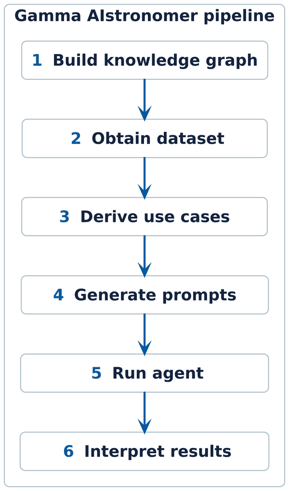

# Gamma AIstronomer

A memory-augmented coding agent for gamma-ray source analysis with the Gammapy library.

An autonomous LLM connected to the Pi or OpenCode harness writes and runs its own Python
analysis on a given dataset. A [Cognee](https://github.com/topoteretes/cognee) knowledge
graph holds its long-term memory, built from Gammapy documentation and gamma-ray astronomy
publications and served over MCP.

Inference goes to any OpenAI-compatible endpoint. We used [Blablador](https://blablador.fz-juelich.de/)
(Helmholtz AI), a DESY assistant and GMI Cloud, all serving open-weight models. Open weights
are cheap to run once set up, keep data local, and give stable results with no silent model
changes. The knowledge graph, the harnesses, the provider and the tasks can all be swapped.

## Pipeline

Six high-level steps. Steps 1 and 2 are one-time setup. Step 3 runs once per dataset, steps 4
to 6 repeat per task.

1. Build a Cognee knowledge graph from Gammapy documentation and H.E.S.S. papers (a few joint
   with MAGIC and VERITAS), and deploy it as a service.
2. Obtain a CTAO dataset to analyze.
3. Derive science use cases and concrete analysis tasks from the dataset and the knowledge
   graph.
4. Generate and verify a prompt template for each task.
5. Run the agent harness on each task.
6. Interpret the results and compare the findings against existing literature.

<div align="center">



</div>

## Repository structure

```txt
.
├── .agents/                skills for the run-archival workflow
├── data/
│   ├── cache/              gitignored, filled per subdir, empty on a fresh clone
│   │   ├── exported/       cogx blobs, from the deployment
│   │   ├── gammapy/        Gammapy sample datasets and the internal CTAO set
│   │   ├── hgps/           catalog FITS, paper and sources.csv, from match_ctao_sources.py
│   │   └── ingestion/      downloaded docs, examples and papers
│   ├── README.md
│   └── resources.json      ingestion download manifest
├── deploy/                 Cognee stack
├── docs/                   gammapy use cases and README images
├── opencode/               OpenCode agent harness
├── pi/                     Pi agent harness
├── prompts/                shared system prompt, use-case prompts and per-task prompt templates
├── src/                    Cognee ingestion, Gammapy analysis notebooks and scripts, the gammai CLI
├── .agents.env.example     template for .agents.env
├── .env.example            template for .env
├── .gitignore
├── AGENTS.md               instructions for coding agents, CLAUDE.md imports it
├── CLAUDE.md
├── CONTRIBUTORS.md         authors
├── LICENSE                 MIT
├── README.md               this file
└── pyproject.toml          package metadata and Python dependencies
```

Tracked files are code, prompt templates and manifests. A working setup also needs `.env`
(from `.env.example`), `.agents.env` (from `.agents.env.example`), the cogx blobs, a DL3
dataset and the Gammapy sample datasets. `.env` configures Cognee and the scripts in `src/`,
`.agents.env` the agent harnesses. The internal CTAO dataset is private and comes from the
project. Public HESS open data covers the environment check notebook.

The scripts, notebooks and the `gammai` CLI run under Python 3.13. `pip install -e .` installs
the dependencies and the `gammai` command:

```bash
# setup
python3.13 -m venv .venv && source .venv/bin/activate
pip install -e .
python -m ipykernel install --user --name gammai
```

## Cognee deployment

Cognee is the memory layer. Rather than a plain search index, it stores a knowledge graph of
entities and relations, each tied to its source text, and answers a natural-language query by
traversing that graph.

The graph is built on the host, exported to the portable cogx format (a directory of
`documents.jsonl`, `entities.jsonl`, `facts.jsonl`, `nodes.jsonl` and `manifest.json` per
dataset), and imported into a Docker volume that the services mount. `cognee-import` reads
the exports from `COGNEE_EXPORT_PATH` (default `data/cache/exported/`) and loads the
`gammapy-cta-hgps` and `hess-papers` blobs into the volume on startup, one at a time,
skipping a dataset that already has items. Most setups take the prebuilt blobs from the
deployment. To build either dataset yourself, or to change what is ingested, run
`src/cognee_ingestion.ipynb` (see the ingestion section below).

Bring up the stack:

1. `cp .env.example .env`, then fill in Cognee's LLM and embedding keys. Adjust the ports,
   `COGNEE_EXPORT_PATH` or `COMPOSE_PROJECT_NAME` if needed.
2. `cd deploy/cognee && docker compose --env-file ../../.env up --build`. `cognee-import`
   populates a fresh volume first. This can take hours, depending on the corpus size and the
   provider rate limit. The backend, frontend and MCP services start once it finishes.
3. Obtain a JWT from the backend with the command below, paste it into `.env` as
   `COGNEE_JWT`, then re-run step 2 so `cognee-mcp` starts with the token. The token only
   works for the backend that issued it. The agents don't need it. They reach `cognee-mcp`
   by URL, local or deployed.

```bash
curl -s -X POST http://localhost:8000/api/v1/auth/login \
  -H "Content-Type: application/x-www-form-urlencoded" \
  -d "username=default_user@example.com&password=default_password" \
  | python3 -c "import json,sys; print(json.load(sys.stdin)['access_token'])"
```

Three services, one interface each:

| Service  | Local URL                  | Used by | Protocol       |
|----------|----------------------------|---------|----------------|
| Backend  | http://localhost:8000      | code    | REST API       |
| Frontend | http://localhost:3000      | humans  | web UI         |
| MCP      | http://localhost:8001/mcp  | agents  | Streamable HTTP |

- the table shows the default ports. Override them in `.env` with `COGNEE_BACKEND_PORT`,
  `COGNEE_MCP_PORT` and `COGNEE_FRONTEND_PORT`, and keep `COGNEE_SERVICE_URL` in step.
  `COGNEE_EXPORT_PATH` sets where the blobs live. `COMPOSE_PROJECT_NAME` runs a second
  isolated stack.
- API docs at `http://localhost:8000/docs`. Login `default_user@example.com` / `default_password`.
- graph visualization (mindmap) needs `ENABLE_BACKEND_ACCESS_CONTROL=true`, which is cognee's default
- a simple recall query takes 10 to 20 seconds

Once a good import finishes, back up the volume instead of ingesting again next time. The
volume is named `<COMPOSE_PROJECT_NAME>_cognee_data`, so `gamma-aistronomer_cognee_data` by
default. Backup compresses the Cognee instance and its imported datasets into a tarball on
the host, at `backup/docker/cognee_data.tar.gz`, so the data survives even if the volume
itself is later deleted. Restore does the reverse: it unpacks that tarball back into the
volume.

```bash
# backup
docker run --rm \
  -v gamma-aistronomer_cognee_data:/root/.cognee:ro \
  -v "$(pwd)/backup/docker:/backup" \
  alpine sh -c "tar czf /backup/cognee_data.tar.gz -C /root/.cognee ."

# restore
docker run --rm \
  -v gamma-aistronomer_cognee_data:/root/.cognee \
  -v "$(pwd)/backup/docker:/backup:ro" \
  alpine tar xzf /backup/cognee_data.tar.gz -C /root/.cognee
```

## Knowledge sources: caching and ingestion

The ingestion pipeline downloads the documents listed in `data/resources.json`, loads the
PDFs into text chunks, and calls `cognee.remember` (LLM plus embeddings) to build a knowledge
graph of entities, relations and source text.

`data/resources.json` is the manifest. It lists the CTA whitepaper, about 240 arXiv papers
(H.E.S.S., a few joint with MAGIC and VERITAS, ingested by citation count), and the Gammapy
documentation and example folders pinned to `v2.1`.

- `src/cognee_ingestion.ipynb` downloads everything into `data/cache/ingestion/`,
  sparse-clones the Gammapy docs at the pinned ref, splits large PDFs, and ingests the
  corpus into two datasets. `gammapy-cta-hgps` holds the Gammapy docs and examples, the
  Gammapy and HESS Galactic Plane Survey (HGPS) papers and the CTA whitepaper.
  `hess-papers` holds the related papers. Both are exported to `data/cache/exported/`.
- `src/cognee_cloud_ingestion.py` runs a reduced version of the same flow against the hosted
  Cognee tenant. It is mostly unused here, kept for quick experimentation or for someone with
  cloud credits.

Two exports live in `data/cache/exported/`:

| Dataset            | Contains                                                          | Documents | Nodes | Edges  | Size   |
|--------------------|------------------------------------------------------------------|-----------|-------|--------|--------|
| `gammapy-cta-hgps` | the HGPS and Gammapy papers, CTA whitepaper, Gammapy docs and tutorials | 271 | 3,936 | 21,044 | 15 MiB |
| `hess-papers`      | the most-cited HESS publications, 70 of 239 papers so far         | 342       | 6,391 | 32,990 | 25 MiB |

- `Documents` counts 10-page split parts, not whole papers. Large PDFs are split first.
- `cognee-import` loads `gammapy-cta-hgps` and `hess-papers`.
- To change what is ingested, edit `data/resources.json` and re-run
  `src/cognee_ingestion.ipynb`. Each dataset has its own cell, so one can be rebuilt alone.

## End-to-end data analysis

### Dataset

Any CTAO dataset in DL3 format works. Development used internal data simulated with Gammapy.
It can include HGPS sources, synthetic PWNe and extragalactic blazars. Put it under
`data/cache/gammapy/ctao-data/`, the folder the agent containers mount. Scripts read it
through `CTAO_DATA_PATH`, set in `.env` to the DL3 DataStore directory inside it, the one
holding `hdu-index.fits.gz` and `obs-index.fits.gz` (`data-transfer/` in `.env.example`). A
relative path there is relative to `src/`, where the scripts run.

The internal dataset is private. For the environment check notebook, use public HESS open
data. `gammapy download datasets` writes it to `./gammapy-datasets/2.1/`, so run it from
`data/cache/gammapy/`.

`src/match_ctao_sources.py` downloads the HGPS catalog and paper and builds
`data/cache/hgps/sources.csv`. It reads the dataset through `CTAO_DATA_PATH`. The file holds
the 78 HGPS sources, trimmed to the columns the analysis uses, each tagged with whether a
CTAO observation covers it.

| Column | Meaning |
|---|---|
| `id` | our 1-based index, not part of the HESS catalog |
| `name` | official HESS designation, e.g. `HESS J0835-455` |
| `source_class` | object type (PWN, SNR, binary, unidentified, ...) |
| `ra_j2000`, `dec_j2000` | equatorial coordinates, decimal degrees |
| `glon`, `glat` | Galactic coordinates, decimal degrees |
| `spatial_model` | shape HESS fitted, e.g. `3-Gaussian` or `Shell` |
| `size_deg` | angular size in degrees, `0` means point-like at HESS resolution |
| `rspec_deg` | radius of the spectral extraction region, degrees |
| `spectral_model` | `PL` (power law) or `ECPL` (cutoff power law) |
| `flux_1tev_diff` | differential flux at 1 TeV, TeV⁻¹ cm⁻² s⁻¹, for the model above |
| `in_ctao` | is a CTAO observation close enough to analyze it (`yes`, `maybe`, `no`) |
| `min_offset_deg` | angular distance to the nearest CTAO pointing |

### Use cases and tasks

We asked Cognee what science use cases the dataset supports and got 16, then how each would
be done with Gammapy. The answers are in [gammapy use cases](docs/gammapy_use_cases.md), the
prompts in `prompts/derive_use_cases/`. Run those prompts against a deployed Cognee, through
the web UI, the backend API or `gammai derive`, to redo this for a new dataset:

```bash
gammai derive -o use_cases.md   # -s GRAPH_COMPLETION_COT for Cognee's chain-of-thought search
```

Prompt 1 asks for science goals only, without tools or methods. Prompt 2 asks how to do each
one with Gammapy, with Prompt 1's answer pasted in. `gammai derive` prints each prompt and
Cognee's answer as they come, and `-o` saves both.

We picked five of the use cases as tasks. Each has its own prompt-template directory under
`prompts/`:

- **source characterization**: independently fit position, size, spectrum and flux
- **acceleration mechanism**: leptonic vs. hadronic from the spectral shape
- **cosmic-ray propagation**: source size across energy bands
- **EBL absorption**: joint fit across extragalactic blazars at different redshifts
- **PeVatron search**: spectral hardness and cutoff toward 100 TeV

All five have been run against the Pi harness.

These HGPS sources make good task targets, all well inside the CTAO footprint and clearly
detected. `HESS Sqrt_TS` is the HGPS catalog value, `CTAO Sqrt_TS` is measured from the CTAO
dataset:

| id   | Name           | Class     | Spatial model | Size (deg) | HESS Sqrt_TS | CTAO Sqrt_TS |
|------|----------------|-----------|---------------|------------|--------------|--------------|
| `12` | HESS J1420-607 | PWN       | Gaussian      | 0.081      | 27.6         | 39.4         |
| `27` | HESS J1640-465 | Composite | 2-Gaussian    | 0.110      | 41.1         | 42.8         |
| `49` | HESS J1804-216 | Unid      | 2-Gaussian    | 0.243      | 34.2         | 13.0         |
| `53` | HESS J1813-178 | Composite | Gaussian      | 0.049      | 26.4         | 170.3        |
| `63` | HESS J1837-069 | PWN       | 3-Gaussian    | 0.355      | 41.5         | 53.9         |

### Running the agent

Each harness is a container with Gammapy 2.1, the HGPS paper and the CTAO dataset mounted,
and Cognee reachable over MCP. It runs autonomously: plan, code, test, report.

Pi reads `pi/models.json`, `pi/settings.json` and `pi/mcp.json`, OpenCode reads
`opencode/opencode.json`. Both are templates with one LLM provider, filled from `.agents.env`
when the container starts. The provider can be a standard hosted service, a self-hosted
open-source model, or an organizational one, which is what we did. Copy `.agents.env.example`
to `.agents.env` and set the provider's endpoint, key, model id and display name, plus
`COGNEE_MCP_URL` pointed at a local or deployed Cognee MCP. With a deployed Cognee, `.env`
only needs `CTAO_DATA_PATH`, for the script below.

Run `cd src && python match_ctao_sources.py` first to fetch the HGPS paper the container
mounts. The dataset, paper and EBL tables mount from their default `data/cache/` paths.
Start the Cognee stack or use a deployed one. `gammai check` tests the Python environment,
`.agents.env`, the data, Docker, the LLM and Cognee MCP. Then run a harness. We ran them
interactively and pasted the prompt as the first message, so we could watch the workspace
change live:

```bash
gammai run pi -i   # cd pi && docker compose -f pi-compose.yml run --rm --build -it pi
```

The prompt is a template from `prompts/<task>/` with its placeholders filled by hand from the
matching columns of the source's row in `sources.csv`. `prompts/system_prompt.md` loads
underneath it. One-shot runs also work:

```bash
gammai run opencode "<prompt>"
gammai run pi -f prompt.md
```

`gammai run` wraps the compose commands and stops if the workspace still holds an earlier run,
unless `--force` is given.

### Validation

We validate the agent by reproducing HGPS source analyses on internal simulated CTAO data.
After the run, the skills under `.agents/` archive the workspace and write a breakdown that
compares the fitted values against the HGPS catalog where it applies. A human reviews the
agent's report. `AGENTS.md` has the full harness setup and the run-archival workflow.

### Checks and overviews

- `gammai check` tests what an agent run needs: the Python environment, `.agents.env`, the
  data, Docker, the LLM and Cognee MCP (see "Running the agent").
- `src/env_and_dataset_check.ipynb` runs the Gammapy ring-background tutorial on public HESS
  DL3 DR1 data (MSH 15-52). It is a library and environment check, and it shows the kind of
  output the agent should produce. Point its `datastore` line at another DL3 store to check
  that too.
- `cd src && python plot_ctao_plane.py` (Galactic plane, needs `sources.csv` from
  `match_ctao_sources.py`) or `plot_ctao_allsky.py` (all-sky) draw significance skymaps of
  the dataset at `CTAO_DATA_PATH`. Raise the `N_OBSERVATIONS` script variable for higher
  quality.

## References

- Gammapy: [library](https://docs.gammapy.org/2.1/), [paper](https://arxiv.org/abs/2308.13584),
  [Gammapy GPT agent](https://arxiv.org/abs/2509.26110)
- [Cognee](https://github.com/topoteretes/cognee) memory layer
- [CTA science whitepaper](https://arxiv.org/abs/1709.07997)
- [HGPS catalog](https://www.mpi-hd.mpg.de/HESS/hgps/) and [paper](https://arxiv.org/abs/1804.02432)
- [pi coding agent](https://github.com/earendil-works/pi), [OpenCode](https://opencode.ai/)
- [AstroAgent](https://astroagent.zeuthen.desy.de/) team projects
- Anthropic on agents: [effective harnesses](https://www.anthropic.com/engineering/effective-harnesses-for-long-running-agents),
  [context engineering](https://www.anthropic.com/engineering/effective-context-engineering-for-ai-agents),
  [measuring autonomy](https://www.anthropic.com/research/measuring-agent-autonomy)
